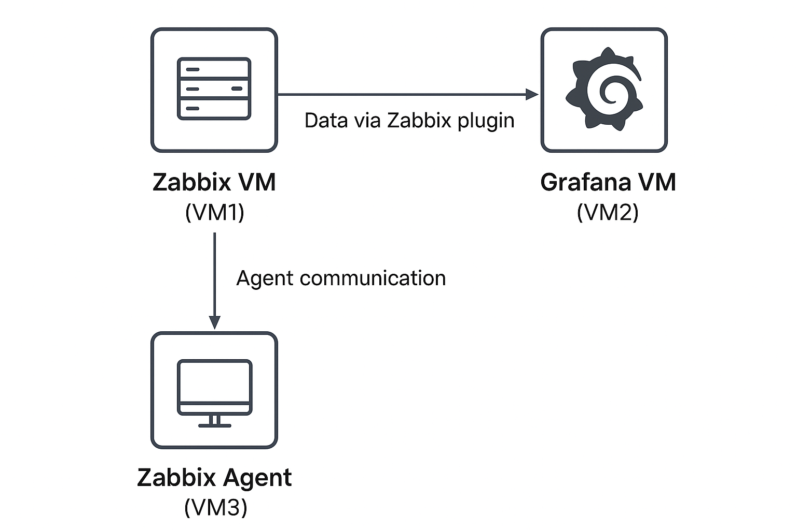

## Introduction

In this project, I built a centralized infrastructure monitoring system using Zabbix and Grafana across three separate virtual machines (VMs). Each VM has a dedicated role in the monitoring architecture:

- **VM1 – Zabbix Server:** Acts as the central monitoring server, running Zabbix Server, MariaDB, and Nginx. It processes monitoring data and provides the Zabbix frontend and API.
- **VM2 – Zabbix Agent (Monitored Host):** Runs Zabbix Agent to collect system metrics such as CPU usage, memory, disk activity, and network performance. The agent communicates with the Zabbix Server using passive and active checks.
- **VM3 – Grafana Server:** Runs Grafana with the Zabbix plugin. It connects to the Zabbix Server through the Zabbix API to retrieve and visualize monitoring data.

The lab uses a distributed architecture where Zabbix handles metric collection and monitoring, while Grafana provides dashboard visualization. I successfully integrated Grafana with Zabbix and displayed monitoring metrics from both VM1 and VM2.

---

## 🔹 VM1 – Zabbix Server + Nginx  

**Purpose:**  
VM1 is the **core of the monitoring system**. It runs Zabbix Server, stores monitoring data, and serves the Zabbix frontend via Nginx.  
**Steps:**  
##### 1. Update OS & Install Dependencies

sudo apt update && sudo apt upgrade -y
sudo apt install wget curl gnupg2 software-properties-common -y


---

##### 2. Install Zabbix Repository & Packages
Download the Zabbix 7.0 LTS repository (stable, long-term support):

wget https://repo.zabbix.com/zabbix/7.0/ubuntu/pool/main/z/zabbix-release/zabbix-release_7.0-2+ubuntu$(lsb_release -rs)_all.deb
sudo dpkg -i zabbix-release_7.0-2+ubuntu$(lsb_release -rs)_all.deb
sudo apt update

Install Zabbix Server + Frontend + Agent:

sudo apt install zabbix-server-mysql zabbix-frontend-php zabbix-nginx-conf zabbix-sql-scripts zabbix-agent -y


---

##### 3. Install & Configure Database (MariaDB/MySQL)
Install MariaDB:

sudo apt install mariadb-server -y
sudo mysql_secure_installation
sudo mysql -uroot -p

Create database & user for Zabbix:

CREATE DATABASE zabbixdb CHARACTER SET utf8 COLLATE utf8_bin;
CREATE USER 'zabbixuser'@'localhost' IDENTIFIED BY 'password';
GRANT ALL PRIVILEGES ON zabbixdb.* TO 'zabbixuser'@'localhost';
FLUSH PRIVILEGES;
EXIT;

Import Zabbix schema:   
- ⚠️ Ensure the schema file exists and the database is empty:

zcat /usr/share/zabbix-sql-scripts/mysql/server.sql.gz | mysql -uzabbixuser -p zabbixdb

- Check imported tables

mysql -uzabbixuser -p zabbixdb -e "SHOW TABLES;"

You should see tables like: users, hosts, etc.
---

##### 4. Configure Zabbix Server
Edit the Zabbix server configuration file:

sudo nano /etc/zabbix/zabbix_server.conf

Find and update:

DBName=zabbixdb
DBUser=zabbixuser
DBPassword=password
DBHost=localhost

*(replace `password` with the one you set for the database user earlier).*

---

##### 5. Troubleshoot Zabbix Runtime Directory

If Zabbix Server fails to start because its runtime directory is missing, check the service logs first:


sudo journalctl -u zabbix-server -n 50 --no-pager


Check whether the runtime directory exists:


ls -ld /run/zabbix


If the directory is missing, investigate the Zabbix systemd service configuration before creating it manually.

##### 6. Configure Nginx for Zabbix Frontend

Edit the default Zabbix Nginx configuration:

```bash
sudo nano /etc/zabbix/nginx.conf
```

Uncomment and adjust the `listen` and `server_name` directives to match your environment:

```nginx
listen 80;
server_name 10.10.10.11;
```

Keep the remaining package-provided configuration unchanged.

Enable the Zabbix Nginx configuration:

```bash
sudo ln -s /etc/zabbix/nginx.conf /etc/nginx/conf.d/zabbix.conf
```

If the default Nginx site conflicts with the Zabbix frontend on port 80, disable the conflicting site.

Validate the Nginx configuration and start the service:

```bash
sudo nginx -t
sudo systemctl restart nginx
sudo systemctl enable nginx
```

##### 7. Configure Firewall for Zabbix Server

Allow the required ports for SSH access, Zabbix frontend, and Zabbix Server communication.

```bash
sudo ufw allow OpenSSH
sudo ufw allow 80/tcp
sudo ufw allow 10051/tcp
sudo ufw enable
sudo ufw status
```

- **TCP 22:** SSH access.
- **TCP 80:** Zabbix frontend and API access.
- **TCP 10051:** Zabbix Server communication, including active agent checks.

##### 8. Configure php.ini
Edit with sed:

sudo sed -i "s/^post_max_size = .*/post_max_size = 32M/" /etc/php/8.1/fpm/php.ini
sudo sed -i "s/^max_execution_time = .*/max_execution_time = 300/" /etc/php/8.1/fpm/php.ini
sudo sed -i "s/^max_input_time = .*/max_input_time = 300/" /etc/php/8.1/fpm/php.ini
sudo sed -i "s/^;date.timezone =.*/date.timezone = Asia\/Jakarta/" /etc/php/8.1/fpm/php.ini


##### 9. Start & Enable Services
Restart and enable Zabbix, Nginx, and PHP:

sudo systemctl restart zabbix-server zabbix-agent nginx php8.1-fpm
sudo systemctl enable zabbix-server zabbix-agent nginx php8.1-fpm


Check service status:

sudo systemctl status zabbix-server
sudo journalctl -xeu zabbix-server


⚠️ If it still fails, make sure:
- Database exists and schema is imported
- zabbix_server.conf is correct
- /run/zabbix folder exists and is owned by zabbix

##### 10. Access Web UI

Open your browser and go to:  
`http://<IP_VM1>`

You will enter the **Zabbix setup wizard**. Follow these steps:

- **Step 1: Welcome**  
Welcome page → click **Next step**.
- **Step 2: Check of prerequisites**  
Zabbix checks PHP modules, database, and dependencies.  
If you see warnings (e.g., timezone, max execution time), adjust in:  
`/etc/php/8.1/fpm/php.ini`  
Example:  

date.timezone = Asia/Jakarta

- **Step 3: Configure DB connection**  
Fill in database details:  
   - **DB type**: MySQL  
   - **Database host**: localhost  
   - **Database name**: zabbixdb  
   - **User**: zabbixuser  
   - **Password**: (the one you set in MariaDB)  
   Click **Next step**.
- **Step 4: Zabbix server details**  
   - Host: `localhost` (leave default)  
   - Port: `10051` (default Zabbix server port)  
   Click **Next step**.
- **Step 5: Pre-installation summary**  
Review all settings → click **Next step**.
- **Step 6: Install**  
The wizard writes config into:  
`/usr/share/zabbix/conf/zabbix.conf.php`  

   If successful → click **Finish**.

---
-  **Default Zabbix Login**

   Use these credentials to log in:  
   
   Username: Admin
   Password: zabbix
   

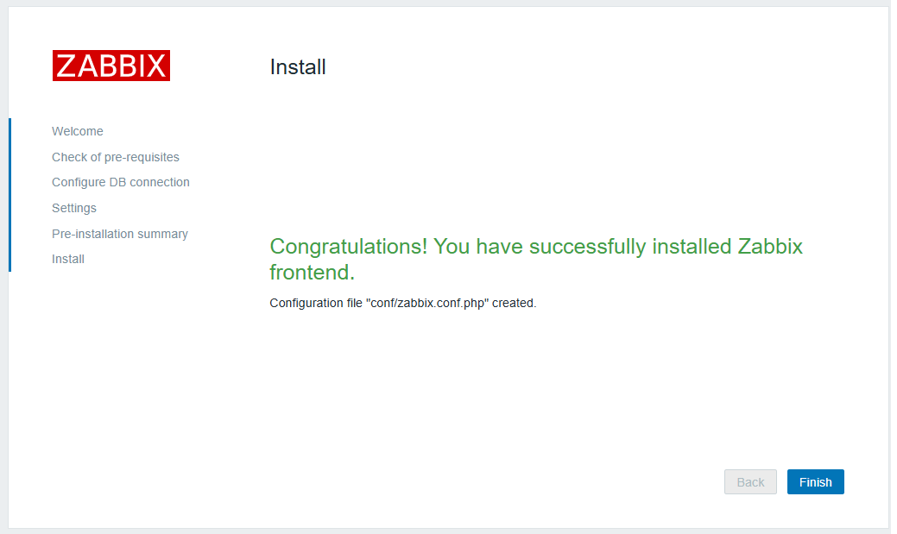


##### Security Note: Secure Your Monitoring Environment

For security reasons, change all default credentials immediately after the first login.

- **Zabbix:** Change the default `Admin` password (`zabbix`).
- **Grafana:** Change the default `admin` password (`admin`).
- **Database:** Use a strong, unique password for the Zabbix database user.
- **API Access:** For Grafana integration, consider creating a dedicated Zabbix API account with read-only permissions to the required hosts and monitoring data instead of using the default administrator account.
- **Network Security:** Restrict access to monitoring services through firewall rules and network segmentation. In production environments, allow access only from trusted systems.

These are recommended security practices for this lab environment.


---

##### 11. Zabbix API Setup
Enable and test the Zabbix API on VM1 so that external applications such as Grafana can access it.
- **1. Check Services.** 
   
   sudo systemctl status zabbix-server
   sudo systemctl status nginx
   sudo systemctl status php8.1-fpm # adjust PHP version if different
   
   
- **2. Test API Endpoint**

  Check the Zabbix API version:

  
curl -X POST \
-H "Content-Type: application/json-rpc" \
-d '{
  "jsonrpc": "2.0",
  "method": "apiinfo.version",
  "params": [],
  "id": 1
}' \
http://10.10.10.11/api_jsonrpc.php
  

  Expected output (example):

  ```json
  {"jsonrpc":"2.0","result":"7.0.x","id":1}

##### ✅ VM1 Setup Completed

At this stage, **VM1 (Zabbix Server)** is fully configured and running:

- **Zabbix Server** is active and connected to the database  
- **Nginx** is configured as the frontend webserver  
- **Zabbix Dashboard** is accessible and login works  
- **Zabbix API** is enabled and accessible to Grafana through the API endpoint.

##### Next Step
Proceed to configure **VM2 (VM-Client)**. The Zabbix Agent sends system metrics to VM1.

---

## 🔹 VM2 – Zabbix Agent (Client)

**Purpose:**  
VM2 acts as the **monitored client**. Zabbix Agent will be installed on VM2 so that CPU, RAM, Disk, Network, etc. metrics can be sent to VM1 (Zabbix Server) → then visualized in Grafana (VM3).

**Steps:**  
##### 1. Update System

sudo apt update && sudo apt upgrade -y


---

##### 2. Install Zabbix Agent
Download the Zabbix 7.0 LTS repository (stable, long-term support):

wget https://repo.zabbix.com/zabbix/7.0/ubuntu/pool/main/z/zabbix-release/zabbix-release_7.0-2+ubuntu$(lsb_release -rs)_all.deb
sudo dpkg -i zabbix-release_7.0-2+ubuntu$(lsb_release -rs)_all.deb
sudo apt update

Install Zabbix Agent:

sudo apt install zabbix-agent -y


##### 3. Configure Zabbix Agent
Edit the Zabbix Agent configuration file:

```bash
sudo nano /etc/zabbix/zabbix_agentd.conf
```

Update the following parameters:

```ini
# IP address of VM1 (Zabbix Server)
Server=10.10.10.11

# Active checks destination
ServerActive=10.10.10.11

# Unique hostname for VM2
Hostname=VM2-Client
```

##### 4. Configure Firewall

Allow SSH access and the port used by Zabbix Server to communicate with the agent.

```bash
sudo ufw allow OpenSSH
sudo ufw allow 10050/tcp
sudo ufw enable
sudo ufw status
```

- **TCP 22:** SSH access.
- **TCP 10050:** Zabbix Agent passive checks.


##### 5. Start & Enable Agent
Restart and enable the agent service:

sudo systemctl restart zabbix-agent
sudo systemctl enable zabbix-agent

Check the service status:

sudo systemctl status zabbix-agent


##### 6. Add VM2 to Zabbix Server (VM1)
Login to Zabbix Web UI on VM1 → http://<IP_VM1>
-  Navigate to: Monitoring → Hosts → Create host

   Fill in:
   - Hostname: VM2-Client (must match Hostname in agent config)
   - Group: Linux servers & Zabbix servers
   - interface: Using Agent & IP of VM2 (ex: 10.10.10.21)
- Go to Templates → Select
   - Click Template/Operating System
   - Choose Template OS Linux by Zabbix agent
- Save.

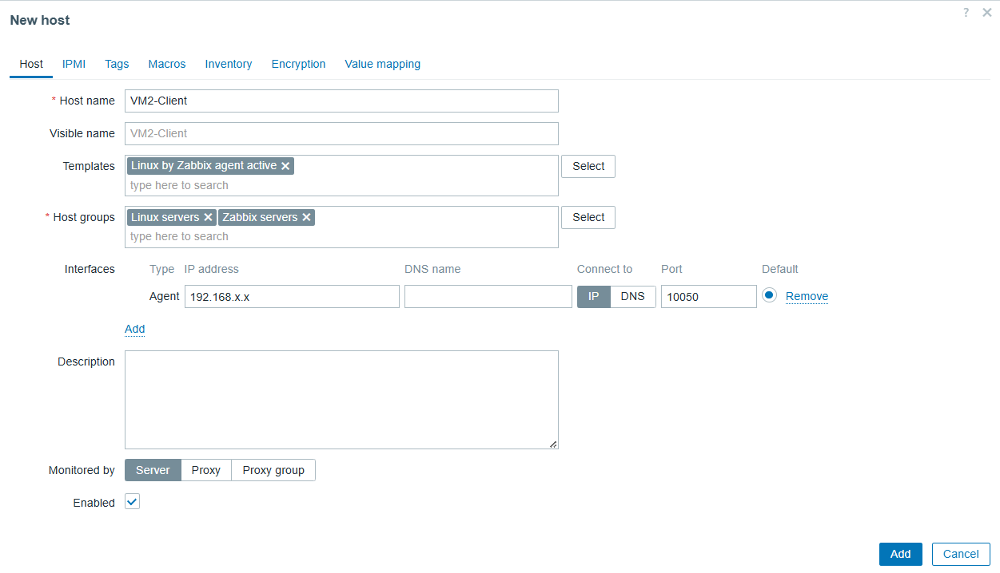

##### 7. Verify in Zabbix
- After a few minutes, go to: Monitoring → Hosts
- The VM2 host should appear with status green (Available) ✅

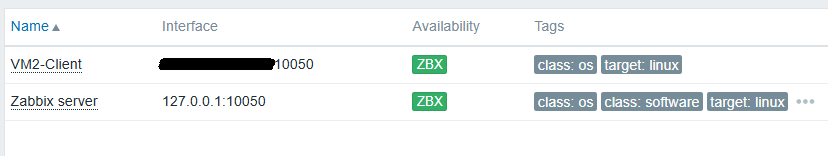

If the status is red (Unavailable):
- Check firewall rules (sudo ufw status)
- Ensure VM1 can reach VM2 on port 10050
- Check agent logs:

sudo tail -f /var/log/zabbix/zabbix_agentd.log


Results after dashboard customization:
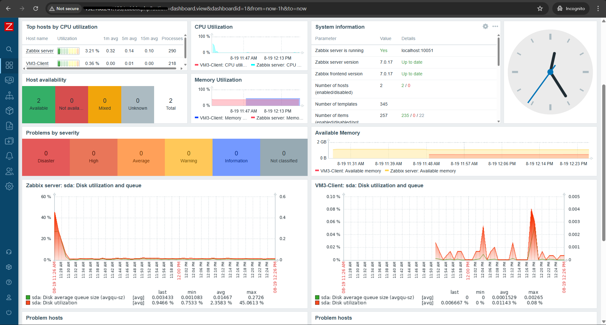

##### ✅ At this point, VM2 is successfully connected and monitored by Zabbix.

## 🔹 VM3 – Grafana Server  

**Purpose:**  
VM3 handles **data visualization**. Grafana connects to Zabbix and provides modern dashboards.  

**Steps:**  

##### 1. Update System
Update all packages to the latest version:

sudo apt update && sudo apt upgrade -y


##### 2. Install Grafana

Install the required dependencies:

```bash
sudo apt-get install -y apt-transport-https software-properties-common wget
```

Create the APT keyrings directory and download the Grafana GPG key:

```bash
sudo mkdir -p /etc/apt/keyrings/
sudo wget -O /etc/apt/keyrings/grafana.asc https://apt.grafana.com/gpg-full.key
sudo chmod 644 /etc/apt/keyrings/grafana.asc
```

Add the Grafana stable repository:

```bash
echo "deb [signed-by=/etc/apt/keyrings/grafana.asc] https://apt.grafana.com stable main" | sudo tee /etc/apt/sources.list.d/grafana.list
```

Update the package list and install Grafana OSS:

```bash
sudo apt update
sudo apt install -y grafana
```

##### 3. Enable & Start Grafana

Enable and start the Grafana service:

```bash
sudo systemctl enable grafana-server
sudo systemctl start grafana-server
```

Check the service status:

```bash
systemctl status grafana-server
```

##### 4. Configure Firewall for Grafana

Allow SSH access and the port used to access the Grafana web interface:

```bash
sudo ufw allow OpenSSH
sudo ufw allow 3000/tcp
sudo ufw enable
sudo ufw status
```

- **TCP 22:** SSH access.
- **TCP 3000:** Grafana web interface.


##### 5. Install Zabbix Plugin for Grafana
To integrate Zabbix with Grafana, install the official plugin:

sudo grafana-cli plugins install alexanderzobnin-zabbix-app

Restart Grafana service:

sudo systemctl restart grafana-server


##### 6. Login to Grafana
Open your browser and go to:  
`http://<IP_VM3>:3000`

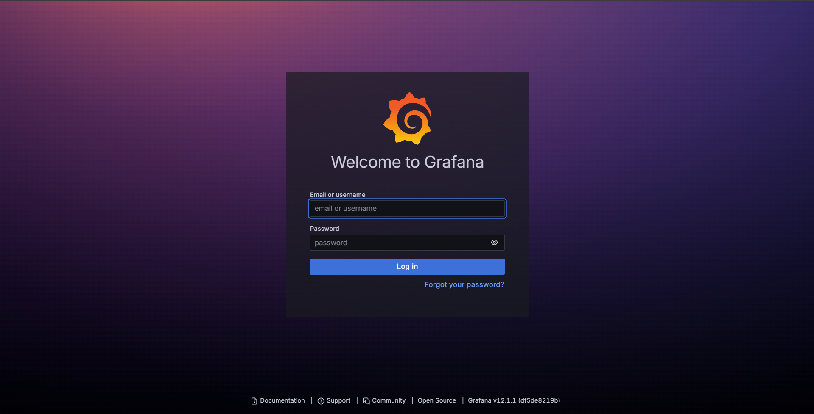

Login using **admin** account. Default login credentials:

Username: admin
Password: admin


> ⚠️ On the first login, Grafana will force you to change the default admin password. 

- **1. Open Zabbix Plugin**
   - Open Grafana and navigate to Administration → Plugins and data → Plugins.
   - Search for Zabbix.
   - Open the Zabbix plugin and make sure it is installed and enabled.

   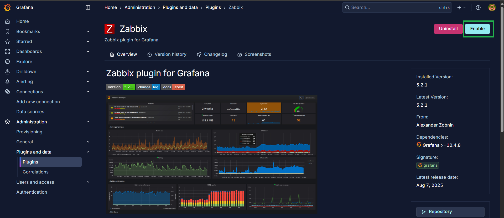

- **2. Open Data Sources Menu**
   - Navigate to Connections → Data sources.
   - Click Add data source.
   - Search for Zabbix
   - Select Zabbix to open its configuration page.

   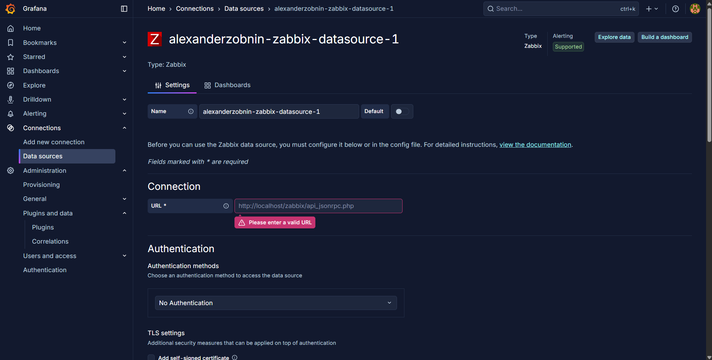

- **3. Configure API Connection**
   Fill in the details to connect Grafana with Zabbix Server (VM1):
   - **URL**   
    `http://10.10.10.11/api_jsonrpc.php`
   - **Access** → Select **Server** (safer, requests are made from Grafana server to Zabbix, not from user browser).

- **4. Enter Zabbix API Credentials**

  Enter the credentials of a Zabbix user authorized to access the monitoring data required by Grafana.

  - **Username:** Zabbix username.
  - **Password:** Password configured for that account.

   For better security, use a dedicated Zabbix API account instead of the default administrator account. Grant it read-only access to the required host groups, hosts, and monitoring data that Grafana needs to query.

- **5. Advanced Options (Optional)**
   - **Trends** → enable this if you want Grafana to query aggregated trend data (faster for long time ranges).  
   - **Cache TTL** → configure caching for faster query response.
- **6. Save & Test**
   Click **Save & Test**.  
   If successful, you will see a green message:  
   `Data source is working ✅`

   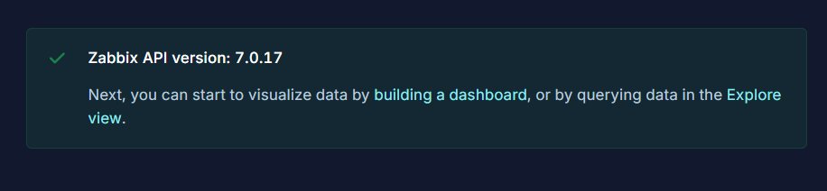


##### 7. Import Zabbix Dashboards into Grafana
Grafana + Zabbix plugin comes with prebuilt dashboards, but you can also import templates from Grafana.com Dashboards

Recommended Templates for Full Monitoring:
- Zabbix Host Monitoring (ID: 5363)
    → CPU, Memory, Disk, Network per host.

To import:
- Go to Grafana → Dashboards → Import → Enter Dashboard ID → Load → Select Zabbix Data Source → Import.

Result:
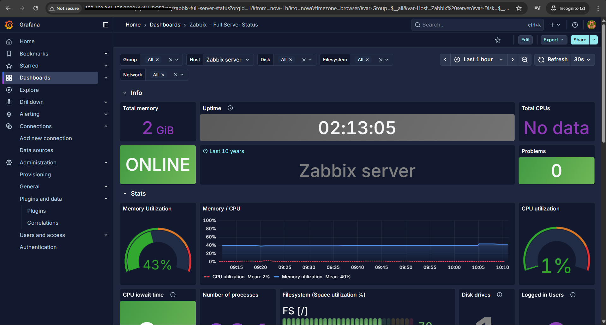

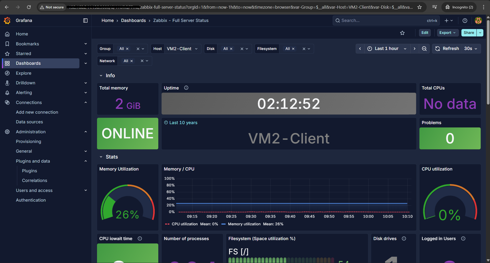

---

## Conclusion

### Summary: Building a Centralized Monitoring System

In this project, I successfully built a centralized infrastructure monitoring environment using three virtual machines:

- **VM1 – Zabbix Server:** Deployed Zabbix Server with MariaDB and Nginx to handle monitoring data and provide the web frontend and API.
- **VM2 – Monitored Linux Host:** Installed and configured Zabbix Agent to collect and provide system metrics to the Zabbix Server.
- **VM3 – Grafana Server:** Deployed Grafana, configured firewall rules, and enabled the Grafana service.

After completing the deployment, I integrated Zabbix with Grafana through API connectivity, installed and enabled the Zabbix plugin, and imported monitoring dashboards.

The resulting dashboards successfully visualized infrastructure metrics from both VM1 and VM2, including CPU, memory, disk, and network performance.

Through this hands-on lab, I gained practical experience in Linux system administration, network configuration, firewall management, infrastructure monitoring, and dashboard visualization.

This project strengthened my understanding of centralized monitoring architecture and the integration of monitoring tools in a Linux environment.